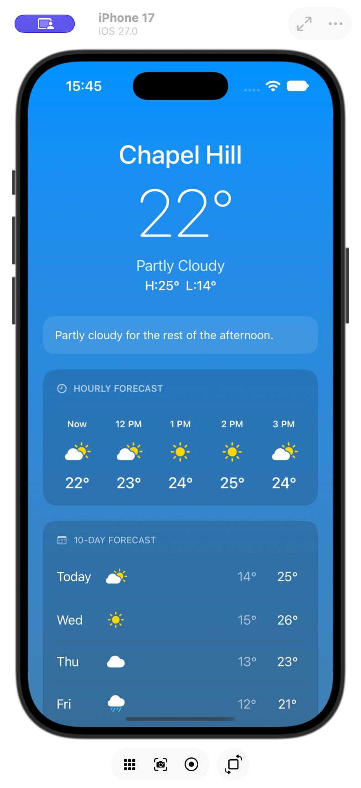

# Weather App

iOS Bootcamp Project 2. A SwiftUI weather screen with sample data, an hourly forecast, and a 10-day forecast. The hourly forecast scrolls sideways.

Open `WeatherApp.xcodeproj` in Xcode and run it on an iPhone simulator.

Still a draft. The temperatures are examples, not live weather.

